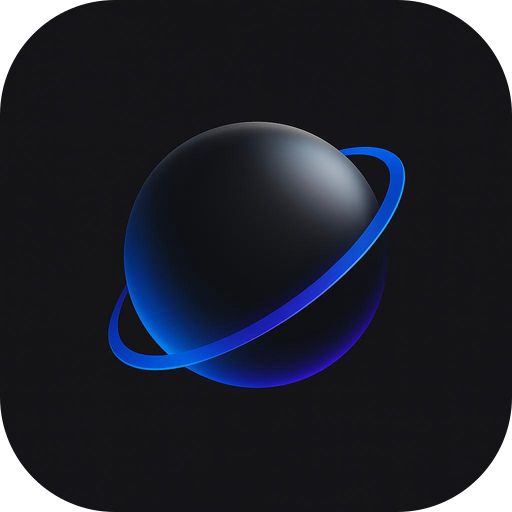
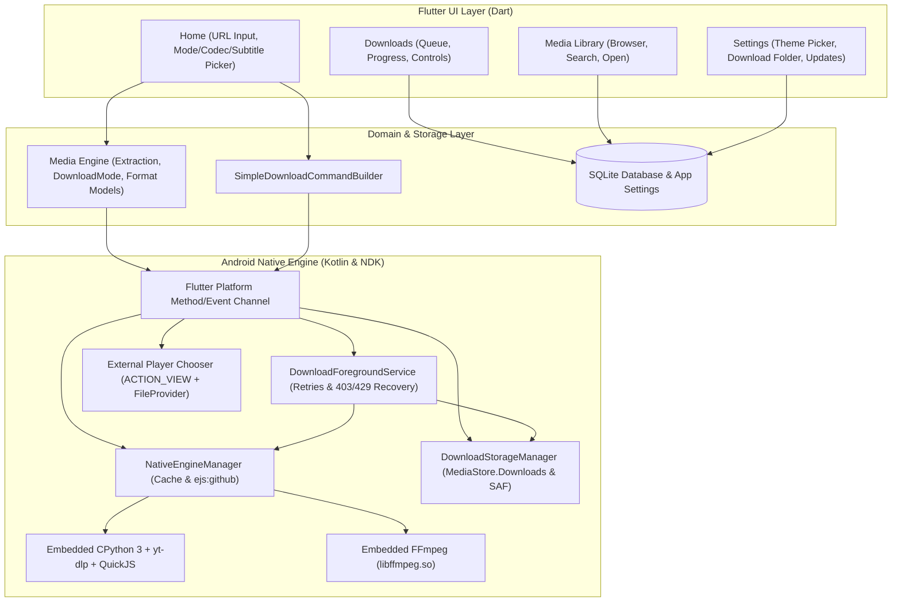

<p align="center">
  
</p>

<h1 align="center">Meteora</h1>

<p align="center">
  <strong>Lightweight, high-performance, open-source Android media downloader powered by yt-dlp, FFmpeg, and Material 3 Expressive.</strong>
</p>

<p align="center">
  <a href="LICENSE"></a>
  <a href="https://flutter.dev"></a>
  <a href="https://kotlinlang.org"></a>
  <a href="https://developer.android.com"></a>
  <a href="https://github.com/meteora-app/meteora-dl/releases"></a>
</p>

---

## 📖 Overview

**Meteora (MeteoraDL)** is an elegant, native Android media downloader engineered for performance, reliability, and privacy. Built with **Flutter**, **Kotlin**, **embedded CPython 3**, **yt-dlp**, **QuickJS-NG / EJS**, and **FFmpeg**, Meteora brings full-fidelity stream extraction and background downloading directly to your device — with no Termux, root access, or external servers required.

---

## ✨ Features

- 🎥 **1,000+ Supported Websites**: Seamless extraction and downloading from YouTube, Instagram Reels, TikTok, Twitter/X, Bilibili, Reddit, SoundCloud, Twitch, Vimeo, Facebook, and hundreds more via the embedded `yt-dlp` engine.
- 🐍 **Embedded Python 3, NDK Runtime & EJS Caching**: Bundles CPython 3, `yt-dlp`, and `QuickJS-NG` via `youtubedl-android`, configures a persistent `ytdlp-cache` directory with `--remote-components ejs:github` for player challenge solving, and automatically applies fallback client/IPv4 recovery on `HTTP 403` and `HTTP 429` errors.
- 🎞️ **Direct Lossless Stream Copy (FFmpeg)**: Embedded `libffmpeg.so` automatically merges separate high-resolution video streams (1080p, 1440p, 4K) and audio streams using `-c copy` without re-encoding, preserving exact original quality while saving battery.
- 🎛️ **Simple Mode, Codec & Subtitle Picker**: Choose directly between **Video + Audio**, **Video Only**, **Audio Only**, and **Subtitles Only**, with dedicated pickers for video resolution/framerate/codec (`AV1`, `VP9`, `H.265`, `H.264`), audio bitrate/codec (`Opus`, `AAC`), and creator or auto-generated subtitle languages (alongside hardware-aware capability detection in `media_engine`).
- ⚡ **Persistent Background Downloads**: Powered by a robust Kotlin `DownloadForegroundService` with notification progress bars, real-time speed (MB/s), ETA calculations, retries, and Wi-Fi/wake locks to prevent OEM task termination.
- 🔄 **In-App Over-The-Air Engine Updates**: Update the embedded `yt-dlp` binary dynamically from official upstream channels directly within the app without waiting for an APK release.
- 🎨 **Material 3 Expressive & Liquid Glass**:
  - **Clean Theme Picker (`Choose theme`)**: Switch between **Follow System**, **Light Mode**, **Dark Mode**, and **AMOLED Black** (`#000000`) with preview swatches persisted in SQLite, plus Android 12+ **Dynamic Color (Monet)** support.
  - **Frosted Liquid Glass**: Real-time `BackdropFilter` blur, directional sheen, specular rim borders, floating bottom dock / tablet navigation rail, glass search/URL bars, and glass modal dialogs/sheets with automatic reduced-motion fallbacks.
- 📋 **Smart Clipboard & Android Share Sheet**:
  - Detects copied media links on app resume with a floating, non-intrusive one-tap inspection action.
  - Fully integrated with Android's system Share menu from any browser or app.
- 📂 **Accessible Public Downloads & Custom Folders (SAF)**: Android 10–15 compliant; publishes completed downloads directly to Android's public **Download** folder (`MediaStore.Downloads` / `Environment.DIRECTORY_DOWNLOADS`) by default or to any user-selected directory via Android's **Storage Access Framework (`ACTION_OPEN_DOCUMENT_TREE`)**, configured at first launch or anytime in Settings.
- ▶️ **External Media Player Integration**: Opens finished videos, audio tracks, and subtitle files in your preferred installed player (VLC, mpv, MX Player, etc.) via Android's `ACTION_VIEW` chooser and `FileProvider`.
- 🔒 **Zero Shell Concatenation & Privacy**: Executes commands through structured, typed argument vectors with no shell interpolation. Completely ad-free, tracker-free, and privacy-respecting.

---

## 🏗️ Architecture & Modular Design



---

## 📥 Downloads & Installation

Precompiled APKs for each release are published under [**Releases**](https://github.com/meteora-app/meteora-dl/releases).

| Architecture | APK Filename | Target Devices | Size |
| :--- | :--- | :--- | :--- |
| **ARM64 (v8a)** *(Recommended)* | `meteora-v0.0.2-arm64-v8a.apk` | Most modern Android phones & tablets (2016+) | ~68 MB |
| **ARM32 (v7a)** | `meteora-v0.0.2-armeabi-v7a.apk` | Older 32-bit Android phones | ~61 MB |
| **x86_64** | `meteora-v0.0.2-x86_64.apk` | Android emulators, ChromeOS, Intel devices | ~72 MB |
| **Universal** | `meteora-v0.0.2-universal.apk` | All supported architectures combined | ~182 MB |

> **Cryptographic Verification**: Every release includes a `checksums.txt` file containing SHA-256 hashes for each APK. Verify your download with:
> ```bash
> sha256sum -c checksums.txt
> ```

---

## 🛠️ Building from Source

### Prerequisites
- [Flutter SDK](https://flutter.dev) (v3.41+ or latest stable)
- [Android SDK & NDK](https://developer.android.com/studio) (`compileSdk 35`, `minSdk 24`, NDK installed)
- [Java Development Kit (JDK)](https://adoptium.net) (Version 17 or 21)

### Steps

1. **Clone the repository**:
   ```bash
   git clone https://github.com/meteora-app/meteora-dl.git
   cd meteora-dl
   ```

2. **Fetch dependencies**:
   ```bash
   flutter pub get
   ```

3. **Run static analysis**:
   ```bash
   flutter analyze
   ```

4. **Execute all test suites**:
   ```bash
   flutter test
   (cd packages/media_engine && flutter test)
   (cd packages/package_manager && flutter test)
   (cd packages/media_library && flutter test)
   ```

5. **Build APK**:
   ```bash
   # Build split APKs per architecture (Recommended)
   flutter build apk --release --split-per-abi

   # Or build a single universal debug APK
   flutter build apk --debug
   ```

6. **Install onto connected device**:
   ```bash
   adb install -r build/app/outputs/flutter-apk/app-arm64-v8a-release.apk
   ```

---

## 🛡️ Security & Privacy

- **Zero Command Injection**: Meteora does not pass raw strings to a shell. All process execution is conducted through typed parameter lists using `YoutubeDLRequest` and native JNI bindings.
- **Strict Android Scoped Storage**: Downloads are staged privately inside app files and explicitly published through Android's `ContentResolver` to public `MediaStore.Downloads` or a user-granted Storage Access Framework (`ACTION_OPEN_DOCUMENT_TREE`) directory, and opened via `FileProvider` read grants (`FLAG_GRANT_READ_URI_PERMISSION`).
- **No CAPTCHA Bypassing**: Meteora respects authentication firewalls and does not attempt to solve bot-gates or circumvent platform security measures.
- **No Trackers**: Meteora contains zero third-party analytics SDKs, advertising libraries, or telemetry trackers.

---

## 🤝 Contributing

Contributions, bug reports, and feature suggestions are welcome! Please review:
- [CONTRIBUTING.md](CONTRIBUTING.md) for contribution workflows and code conventions.
- [AGENTS.md](AGENTS.md) for canonical architectural standards.
- [SECURITY.md](SECURITY.md) for vulnerability reporting guidelines.

---

## 📜 License

Meteora is licensed under the [GNU General Public License v3.0 (GPL-3.0-or-later)](LICENSE). Third-party dependencies retain their respective open-source licenses.
