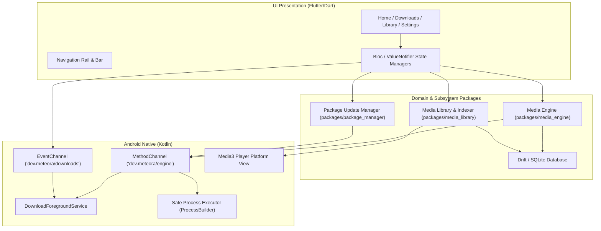
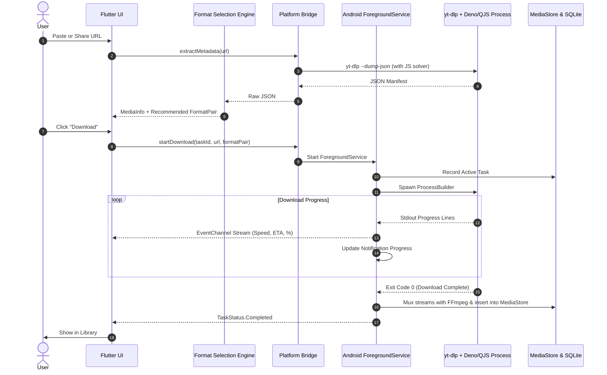

# Meteora System Architecture Specification

## 1. High-Level Architecture Overview

Meteora is structured using clean architecture principles, maintaining a strict boundary between UI presentation, domain business logic, and native platform services.

---

## 2. Subsystem Boundaries and Interfaces

### A. Media Extraction & Format Selection (`packages/media_engine`)
- **Input**: User-provided media URL, device profile (screen width, height, refresh rate, supported codecs), network status (Wi-Fi, mobile, metered), and storage availability.
- **Processing**:
  - Direct invocation of `yt-dlp --dump-single-json --no-warnings`.
  - JSON parser parses stream manifests, distinguishing audio-only, video-only, and combined streams.
  - **Intelligent Format Selection Engine** calculates fitness scores for each format pair (video + audio), prioritizing native hardware decode without downscaling or re-encoding.
- **Output**: Typed `MediaInfo` entity and recommended `FormatPair` for instant download or custom selection.

### B. Background Execution & Download Persistence (`android/`)
- Long-running downloads are managed exclusively by Android's `DownloadForegroundService`.
- Communication with Flutter happens through bidirectional channels:
  - `MethodChannel`: Task commands (`startDownload`, `pauseDownload`, `cancelDownload`, `probeUrl`).
  - `EventChannel`: Real-time streaming progress events (`progressPercent`, `bytesDownloaded`, `speedBps`, `etaSeconds`, `status`).
- Download tasks are stored in SQLite. If the app process is killed or the device restarts, the service queries interrupted tasks upon initialization and automatically resumes partially downloaded streams using HTTP range requests (`-c` flag in yt-dlp).

### C. JavaScript Runtime & Challenge Solving (`android/` + `packages/package_manager`)
- YouTube enforces dynamic signature and `n`-parameter throttling logic in client-side JavaScript.
- Meteora manages standalone binaries for:
  1. **Deno**: Full-featured, sandboxed V8 runtime executing `yt-dlp-ejs`.
  2. **QuickJS-NG**: Ultra-compact (~1.2MB), native NDK-compiled JavaScript engine with near-instant startup.
- `yt-dlp` is configured with `--js-runtimes deno:/path/to/deno` or `--js-runtimes quickjs:/path/to/qjs`.

### D. Package Update Manager (`packages/package_manager`)
- Decouples core media extractor updates from Google Play / APK app updates.
- Pulls from official GitHub releases:
  - `yt-dlp/yt-dlp`
  - `yt-dlp/ejs`
  - `deno / quickjs-ng`
  - `FFmpeg / FFprobe`
- Staging directory workflow:
  1. Download archive into staging directory.
  2. Verify SHA-256 cryptographic checksum.
  3. Set executable flags (`chmod 700`).
  4. Perform atomic directory swap with active binary directory.
  5. Retain previous version in `backup` directory for instant rollback on verification failure.

---

## 3. Data Flow Diagram

