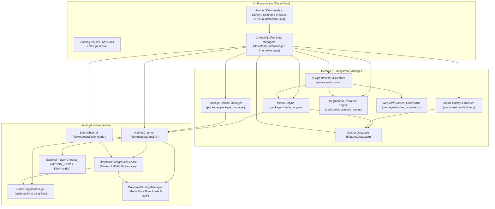
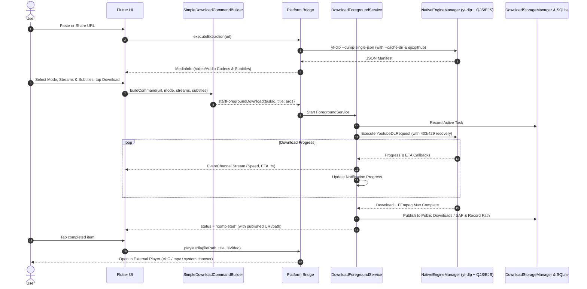

# Meteora System Architecture Specification

## 1. High-Level Architecture Overview

Meteora is structured using clean architecture principles, maintaining a strict boundary between UI presentation, domain business logic, and native platform services.

---

## 2. Subsystem Boundaries and Interfaces

### A. Media Extraction & Download Mode Selection (`packages/media_engine`)
- **Input**: User-provided media URL plus optional user choices for download mode (`DownloadMode`: `videoAudioSubtitles`, `videoOnly`, `audioOnly`, `subtitlesOnly`), video resolution/fps/codec stream, audio bitrate/codec stream, and subtitle tracks (`SubtitleTrackInfo`).
- **Processing**:
  - Direct invocation of `yt-dlp --dump-single-json --no-warnings`.
  - JSON parser extracts stream manifests (`selectableVideoFormats`, `selectableAudioFormats`) and both creator and auto-generated captions (`availableSubtitleTracks`).
  - **Command Builder (`SimpleDownloadCommandBuilder`)** constructs typed `yt-dlp` argument arrays for the user's explicit video, audio and subtitle selections. `DeviceCapabilities` is used only for hardware diagnostics shown in Settings.
- **Output**: Typed `MediaInfo` entity and structured `List<String>` argument vectors passed to Android native services.

### B. Background Execution, Resilience & Storage (`android/`)
- Long-running downloads run inside Android's `DownloadForegroundService` (`foregroundServiceType="dataSync"`).
- Communication with Flutter happens through bidirectional channels:
  - `MethodChannel` (`dev.meteora/engine`): `executeExtraction`, `startForegroundDownload`, `cancelDownload`, `enqueueDirectDownload`, `pauseDirectDownload`, `resumeDirectDownload`, `removeDirectDownload`, `listDirectDownloads`, `getWebViewAuthContext`, `getDownloadLocation`, `pickDownloadDirectory`, `resetDownloadLocation`, `getPermissionStatus`, `requestPermissions`, `playMedia`, `getDeviceCapabilities`, and engine version/update calls.
  - `EventChannel` (`dev.meteora/downloads`): Real-time streaming progress events (`percent`, `speed`, `eta`, `totalSize`, `filePath`, `status`).
- `DownloadForegroundService` stages output in app cache/files, applies retry counts (`--retries 5`, `--fragment-retries 10`, `--extractor-retries 3`), cleans up partial `.part`/`.ytdl` files and retries with fallback `youtube:player_client=tv,android_vr,visionos` on `HTTP 403`, and falls back to media-only download if subtitle fetching hits YouTube `HTTP 429` rate limiting.
- Completed files are published by `DownloadStorageManager` to the public `Download` directory (`MediaStore.Downloads` / `Environment.DIRECTORY_DOWNLOADS`) by default or to a user-selected SAF tree URI (`ACTION_OPEN_DOCUMENT_TREE`). Finished media and subtitle files open in external player apps via `Intent.ACTION_VIEW` + `FileProvider`.

### C. JavaScript Runtime & Challenge Solving (`android/` + `packages/package_manager`)
- YouTube enforces dynamic signature and `n`-parameter throttling logic in client-side JavaScript.
- Meteora bundles `QuickJS-NG` (`libqjs.so` via `youtubedl-android`) and supports standalone binaries via `package_manager` for:
  1. **Deno**: Full-featured, sandboxed V8 runtime executing `yt-dlp-ejs`.
  2. **QuickJS-NG**: Ultra-compact (~1.2MB), native NDK-compiled JavaScript engine with near-instant startup.
- `NativeEngineManager` configures `--cache-dir <app_cache>/ytdlp-cache` (overriding `youtubedl-android`'s `--no-cache-dir` fallback), `--remote-components ejs:github`, and active-interface `--force-ipv4` so updated `yt-dlp` releases download and cache current EJS solver bundles.

### D. Package Update Manager (`packages/package_manager`)
- Decouples core media extractor updates from Google Play / APK app updates.
- Pulls from official GitHub releases:
  - `yt-dlp/yt-dlp`
  - `yt-dlp/ejs`
  - `deno / quickjs-ng`
  - `FFmpeg / FFprobe`
- Staging directory workflow:
  1. Download archive into staging directory.
  2. Verify SHA-256 cryptographic checksum.
  3. Set executable flags (`chmod 700`).
  4. Perform atomic directory swap with active binary directory.
  5. Retain previous version in `backup` directory for instant rollback on verification failure.

### E. In-App Browser & Media Capture (`packages/browser`)
- **Why**: Android sandboxes browsers, so cookies, user agent, referer and request headers of an external Firefox/Chrome session cannot be read. Pages loaded in the built-in WebView are the only first-party auth context available to a download.
- **Processing**:
  - `WebViewScreen` (`webview_flutter`) hosts pages and injects `mediaCaptureScript` on every navigation.
  - The script reports `<video>`/`<audio>` sources and `performance` resource entries through the `MeteoraMedia` JavaScript channel (WebView has no response-header hook).
  - `MediaCandidateCollector` drops HLS/DASH segments, de-duplicates and caps the list; `MediaProbe` classifies each URL as video/audio/HLS/DASH/subtitle/document/archive.
  - `BrowserAuthContext` → `EngineDownloadBridge` → `DownloadRequest`, so a captured download carries the same session it was discovered in.
  - Picked candidates: pages, HLS and DASH go to the Home extraction flow so yt-dlp still owns format selection; plain files (`DirectDownloadPolicy`) start a segmented direct download that reuses this WebView's cookies and user agent.

### F. Segmented Download Engine (`packages/download_engine` + `android/.../direct`)
- **Domain (Dart)**: `SegmentPlanner` splits a known content length into contiguous byte ranges, `DownloadScheduler` enforces a global cap plus a per-host cap, and `DownloadTaskStore` persists the queue atomically (temp file + rename, corrupt queue quarantined, interrupted `running` tasks demoted to `paused`). `DirectDownloadPolicy` routes a URL to the segmented transport or to `yt-dlp`; `DownloadEngine` is the transport-neutral facade (`NativeDirectDownloadEngine` implements it over the method channel).
- **Native transport (Kotlin, `direct/`)**: `SegmentedHttpDownloader` probes with `Range: bytes=0-0`, then fetches N contiguous ranges in parallel over `HttpURLConnection`, writing them at their offsets into one pre-sized `.part` file (`FileChannel` positional writes). Per-range progress is persisted, so a resume only re-requests unfinished ranges; the probe and every range retry with exponential backoff, `Accept-Encoding: identity`/`If-Range` prevent mixed-version splices, and redirects are followed manually with `DirectUrlGuard` re-validated on each hop. Servers that ignore `Range` or omit `Content-Length` fall back to a single sequential stream.
- **Queue (Kotlin)**: `DirectDownloadQueue` owns scheduling (`maxConcurrent = 3`, `maxPerHost = 1`), pause/resume/cancel, and event emission from inside `DownloadForegroundService`, so the queue survives the Flutter activity being destroyed. Finished files are published through the same `DownloadStorageManager` path as `yt-dlp` output. See ADR-009.

### G. WebView Content Extensions (`packages/content_extensions`)
- `ContentBlocker` adapts uBlock Origin / Dark Reader / Violentmonkey *behaviour* to what WebView actually offers: cosmetic filters become injected CSS, Dark Reader settings become a `filter` declaration, userscripts are URL-pattern matched and injected as JS.
- No WebExtension API (request blocking, `chrome.*`) is claimed; that requires GeckoView.

---

## 3. Data Flow Diagram

