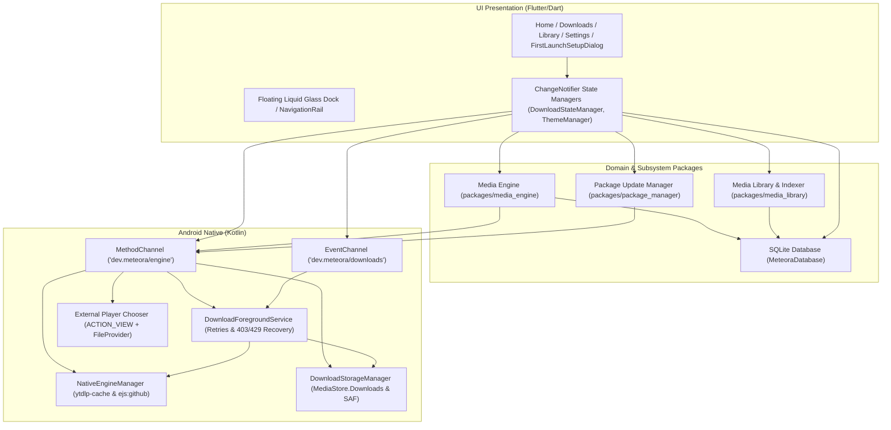
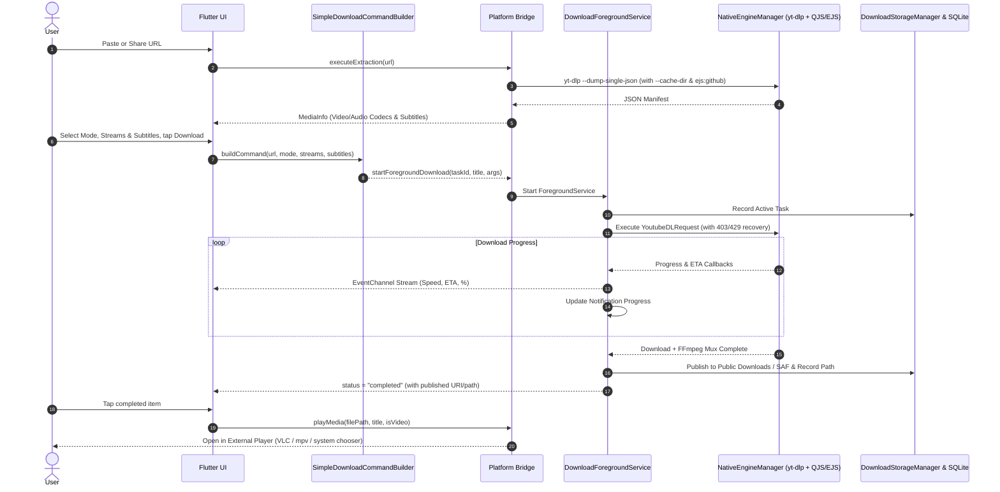

# Meteora System Architecture Specification

## 1. High-Level Architecture Overview

Meteora is structured using clean architecture principles, maintaining a strict boundary between UI presentation, domain business logic, and native platform services.

---

## 2. Subsystem Boundaries and Interfaces

### A. Media Extraction & Download Mode Selection (`packages/media_engine`)
- **Input**: User-provided media URL plus optional user choices for download mode (`DownloadMode`: `videoAudioSubtitles`, `videoOnly`, `audioOnly`, `subtitlesOnly`), video resolution/fps/codec stream, audio bitrate/codec stream, and subtitle tracks (`SubtitleTrackInfo`).
- **Processing**:
  - Direct invocation of `yt-dlp --dump-single-json --no-warnings`.
  - JSON parser extracts stream manifests (`selectableVideoFormats`, `selectableAudioFormats`) and both creator and auto-generated captions (`availableSubtitleTracks`).
  - **Command Builder (`SimpleDownloadCommandBuilder`)** constructs typed `yt-dlp` argument arrays for explicit user selections while preserving `IntelligentFormatSelector` for hardware-aware analysis (`DeviceCapabilities`).
- **Output**: Typed `MediaInfo` entity and structured `List<String>` argument vectors passed to Android native services.

### B. Background Execution, Resilience & Storage (`android/`)
- Long-running downloads run inside Android's `DownloadForegroundService` (`foregroundServiceType="dataSync"`).
- Communication with Flutter happens through bidirectional channels:
  - `MethodChannel` (`dev.meteora/engine`): `executeExtraction`, `startForegroundDownload`, `cancelDownload`, `getDownloadLocation`, `pickDownloadDirectory`, `resetDownloadLocation`, `getPermissionStatus`, `requestPermissions`, `playMedia`, `getDeviceCapabilities`, and engine version/update calls.
  - `EventChannel` (`dev.meteora/downloads`): Real-time streaming progress events (`percent`, `speed`, `eta`, `totalSize`, `filePath`, `status`).
- `DownloadForegroundService` stages output in app cache/files, applies retry counts (`--retries 5`, `--fragment-retries 10`, `--extractor-retries 3`), cleans up partial `.part`/`.ytdl` files and retries with fallback `youtube:player_client=tv,android_vr,visionos` on `HTTP 403`, and falls back to media-only download if subtitle fetching hits YouTube `HTTP 429` rate limiting.
- Completed files are published by `DownloadStorageManager` to the public `Download` directory (`MediaStore.Downloads` / `Environment.DIRECTORY_DOWNLOADS`) by default or to a user-selected SAF tree URI (`ACTION_OPEN_DOCUMENT_TREE`). Finished media and subtitle files open in external player apps via `Intent.ACTION_VIEW` + `FileProvider`.

### C. JavaScript Runtime & Challenge Solving (`android/` + `packages/package_manager`)
- YouTube enforces dynamic signature and `n`-parameter throttling logic in client-side JavaScript.
- Meteora bundles `QuickJS-NG` (`libqjs.so` via `youtubedl-android`) and supports standalone binaries via `package_manager` for:
  1. **Deno**: Full-featured, sandboxed V8 runtime executing `yt-dlp-ejs`.
  2. **QuickJS-NG**: Ultra-compact (~1.2MB), native NDK-compiled JavaScript engine with near-instant startup.
- `NativeEngineManager` configures `--cache-dir <app_cache>/ytdlp-cache` (overriding `youtubedl-android`'s `--no-cache-dir` fallback), `--remote-components ejs:github`, and active-interface `--force-ipv4` so updated `yt-dlp` releases download and cache current EJS solver bundles.

### D. Package Update Manager (`packages/package_manager`)
- Decouples core media extractor updates from Google Play / APK app updates.
- Pulls from official GitHub releases:
  - `yt-dlp/yt-dlp`
  - `yt-dlp/ejs`
  - `deno / quickjs-ng`
  - `FFmpeg / FFprobe`
- Staging directory workflow:
  1. Download archive into staging directory.
  2. Verify SHA-256 cryptographic checksum.
  3. Set executable flags (`chmod 700`).
  4. Perform atomic directory swap with active binary directory.
  5. Retain previous version in `backup` directory for instant rollback on verification failure.

---

## 3. Data Flow Diagram

