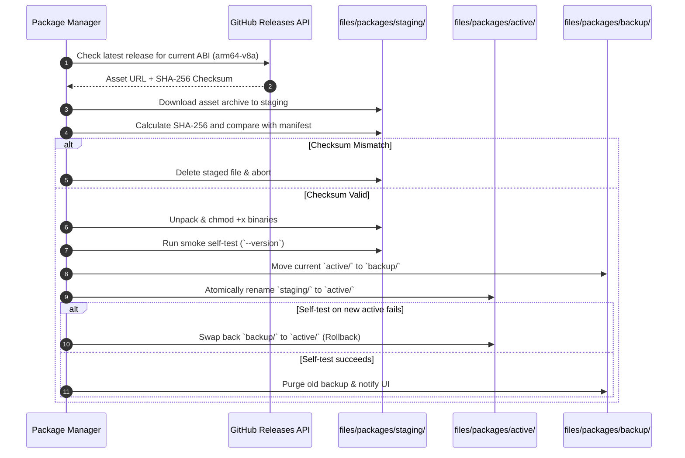

# Package Update Manager & Atomic Staging

## 1. Motivation
Streaming platforms frequently alter their internal APIs and player obfuscation scripts. If an app depends on routine Google Play / APK releases to update its extractor, it risks prolonged downtime when an extractor breaks.

Meteora implements an independent, in-app Package Update Manager for:
- `yt-dlp`
- `yt-dlp-ejs`
- `deno`
- `quickjs-ng`
- `ffmpeg` & `ffprobe`

---

## 2. Directory Layout

All active, staged, and backup packages reside within the app's protected internal storage (`context.filesDir`):

```
/data/user/0/dev.meteora/files/packages/
├── active/
│   ├── ytdlp/
│   │   ├── yt-dlp
│   │   └── version.json
│   ├── ejs/
│   │   ├── yt-dlp-ejs.bundle.js
│   │   └── version.json
│   ├── js_runtime/
│   │   ├── deno (or qjs)
│   │   └── version.json
│   └── ffmpeg/
│       ├── ffmpeg
│       ├── ffprobe
│       └── version.json
├── staging/
│   └── ... (incoming downloads undergoing verification)
└── backup/
    └── ... (previous known-good version for rollback)
```

---

## 3. Update Channels

Users can select their preferred release channel per package or globally:
- **Stable**: Official stable releases from upstream GitHub tags.
- **Nightly**: Daily automated builds for rapid adaptation to YouTube changes.
- **Manual**: User controls updates; auto-checks can be disabled.

---

## 4. Staging, Verification, and Atomic Swap Algorithm


